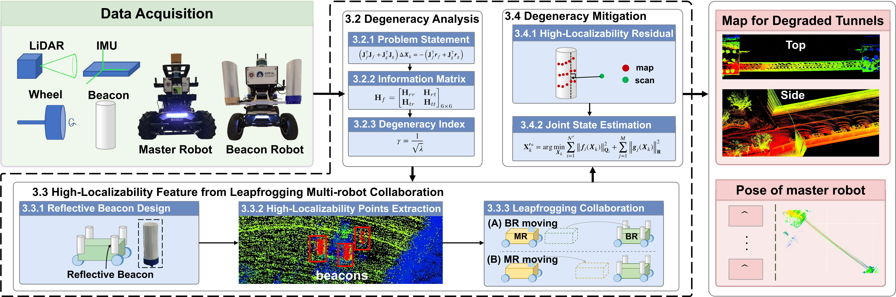
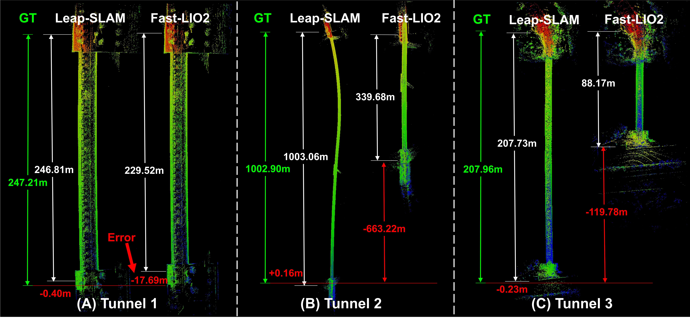
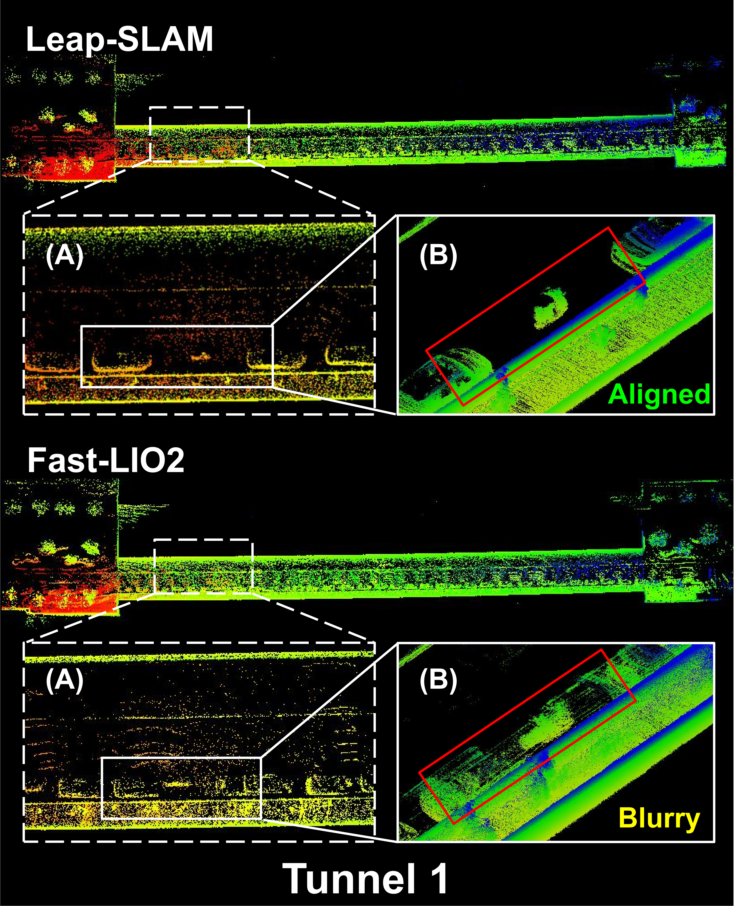

<div align="center">
  <h1>Leap-SLAM</h1>
  
  <p>
    <a href="https://doi.org/10.1016/j.inffus.2026.104538"></a>
    <a href="docs/paper.pdf"></a>
    <a href="https://js-ch3n.github.io/leap-slam.io/"></a>
    <a href="https://huggingface.co/datasets/js-ch3n/leap-slam-dataset-in-3-tunnels"></a>
    <a href="LICENSE"></a>
  </p>
</div>

## 📰 News
- **2026-06-05:** Our paper has been accepted by **Information Fusion**! 🎉  
- **2026-06-17:** The DOI is now available: [10.1016/j.inffus.2026.104538](https://doi.org/10.1016/j.inffus.2026.104538)

## 🗂️ Pipeline
<div align="center">
  
</div>

## 💾 Dataset
All the rosbag data used in this project can be downloaded from [Hugging Face](https://huggingface.co/datasets/js-ch3n/leap-slam-dataset-in-3-tunnels) ([tunnel1.bag](https://huggingface.co/datasets/js-ch3n/leap-slam-dataset-in-3-tunnels/resolve/main/tunnel1.bag), [tunnel2.bag](https://huggingface.co/datasets/js-ch3n/leap-slam-dataset-in-3-tunnels/resolve/main/tunnel2.bag), [tunnel3.bag](https://huggingface.co/datasets/js-ch3n/leap-slam-dataset-in-3-tunnels/resolve/main/tunnel3.bag)).

## ⚙️ Prerequisites
### 1. System Requirements
* **OS:** Ubuntu 20.04.
* **ROS:** Noetic. Follow the [official ROS Installation guide](http://wiki.ros.org/ROS/Installation).

### 2. Dependencies
* **PCL (>= 1.8):** Follow the [PCL Installation guide](http://www.pointclouds.org/downloads/linux.html).
* **Eigen (>= 3.3.4):** Follow the [Eigen Installation guide](http://eigen.tuxfamily.org/index.php?title=Main_Page).

### 3. Hardware Drivers
* **livox_ros_driver:** Required for Livox LiDAR integration. Follow the [official installation instructions](https://github.com/Livox-SDK/livox_ros_driver).

## 🛠️ Build & Installation
Clone the repository and build using `catkin_make`:
```bash
mkdir -p ~/leap_ws/src
cd ~/leap_ws/src
git clone https://github.com/G-SEI-Lab/Leap-SLAM.git
cd ..
catkin_make
source devel/setup.bash
```

## 🚀 Results & Demonstrations
We validated the superiority of our algorithm in three tunnel scenarios. Below are the comparison results with Fast-LIO2.

### Tunnel Mapping Length Comparison
Mapping length comparison across the three tunnels.

<div align="center">
  
</div>

### Tunnel Mapping Detail Comparison
Detailed comparison in one of the tunnels.

<div align="center">
  
</div>

## Open Issues

### Tunnel 2 run-to-run variation

With high-localizability constraints enabled, the pipeline bypasses the
`getReflectivePoints()` call, filters points with `intensity > 200`, and then
voxel-downsamples the selected points. An instrumented build using the original
stationary gate produced an RTK endpoint-distance error of **0.162 m** in one run,
close to the **0.16 m** reported in Table 2. Three runs of the same `best` binary
(commit `173566a`) with the same Tunnel 2 bag and 1× playback produced
**1.049 m**, **0.855 m**, and **0.777 m**, with identical first and last pose
timestamps.

The original gate reads the latest wheel-odometry callback state when processing
each scan. Callback timing near stop–start transitions may change which scans
update the estimator. The cause of the observed variation remains unconfirmed.

The proposed change is to preserve the existing stationary thresholds and
three-sample confirmation, buffer the resulting states with their wheel-odometry
timestamps, and have `sync_packages()` attach to `MeasureGroup` the latest
state at or before the scan end once wheel data covers that time. Verify that
both sensors use the same time base and define how to handle missing wheel data.
Repeat the same replay and compare per-scan gate decisions, trajectory
repeatability, and RTK endpoint-distance errors against the baseline above.

## 📝 Citation

If you find this work useful, please cite our paper:

```bibtex
@article{chen2026leap,
  title={Leap-SLAM: Degeneracy-Mitigated Robust SLAM with Leapfrogging Multi-robot Collaboration in Tunnels},
  author={Chen, Shoubin and Chen, Jiasheng and Zhang, Baiyang and Yan, Maosheng and Li, Jianping and Zhang, Bo and Li, Qingquan},
  journal={Information Fusion},
  pages={104538},
  year={2026},
  publisher={Elsevier}
}
```

## Acknowledgement
This project is built upon the foundational work of [FAST-LIO2](https://github.com/hku-mars/FAST_LIO). We highly recommend referring to their repository for deeper insights into the core framework.